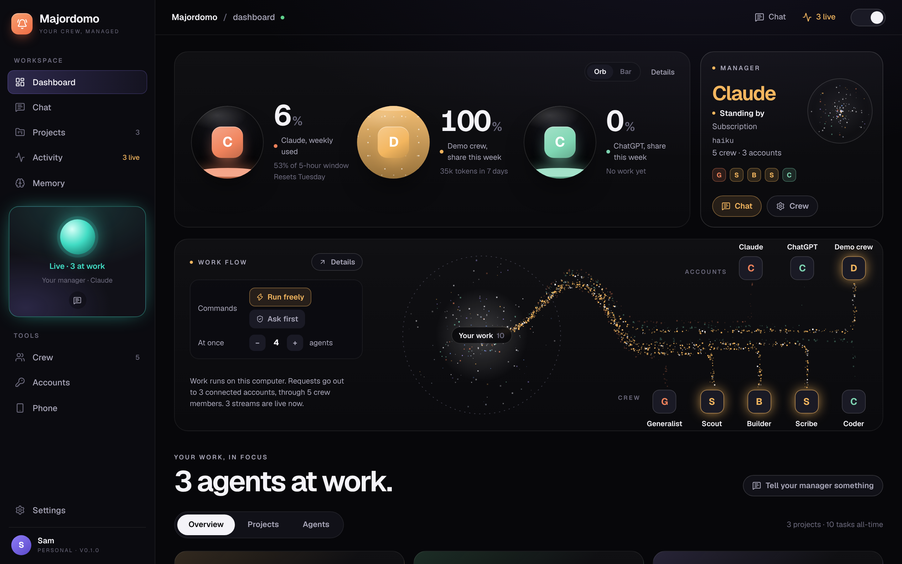
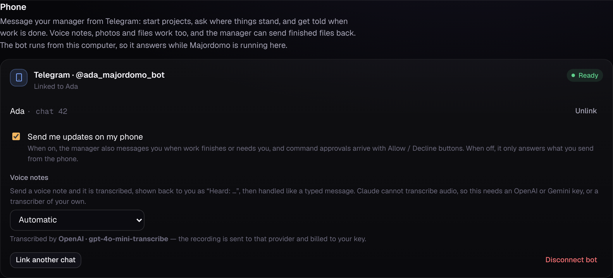
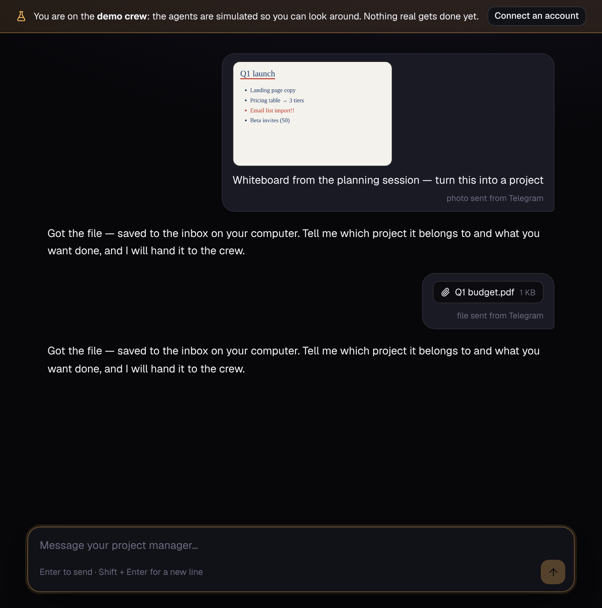
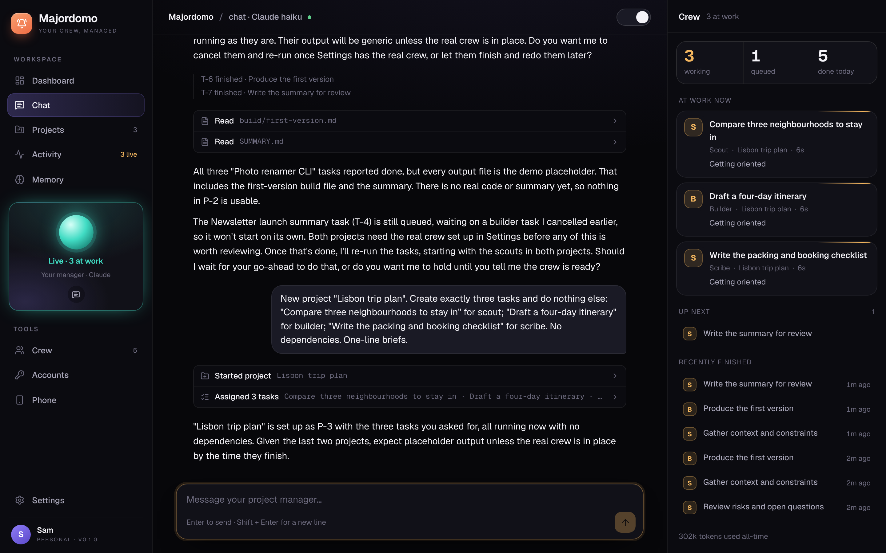

# Majordomo

A personal project manager that runs a crew of AI agents for you.

You talk to **one** agent. Tell it about anything you are working on — a feature, a trip, a report, a bug — and it
records the project, breaks it into tasks, hands each task to a worker agent, tracks them, checks the results, and
reports back. You never juggle threads. A dashboard shows every project, task and agent live.



It runs on your own machine and uses the AI accounts you already have: **Claude, OpenAI/ChatGPT, Gemini, Meta Muse
and OpenRouter**, in any mix.

## Quick start

Requires Node 20.11+ on macOS, Linux or WSL (agents use `bash`).

```bash
npm install
```

```bash
npm start
```

Open <http://localhost:4317>. With no account connected you land on the **demo crew** — simulated agents driving the
real harness — so you can look around first. Then go to **Settings → Accounts**, connect one, and press
**Use for manager & crew**.

To run the demo crew on purpose, even with keys in your environment:

```bash
npm run demo
```

## Connecting your accounts

There are two ways an account can be used, and they are billed differently.

| Account | Subscription (flat plan) | API key (per token) |
| --- | --- | --- |
| **Claude** | Claude Code CLI — sign in once with `claude` | `ANTHROPIC_API_KEY` or paste in Settings |
| **OpenAI** | Codex CLI — `npm i -g @openai/codex`, then `codex login` | `OPENAI_API_KEY` |
| **Gemini** | Gemini CLI — `npm i -g @google/gemini-cli`, then `gemini` | `GEMINI_API_KEY` |
| **Meta Muse** | — (Meta offers Muse to developers by API key only) | `MODEL_API_KEY` |
| **OpenRouter** | — (prepaid credits) | `OPENROUTER_API_KEY` |

**Subscriptions** work through each vendor's own command-line agent. The CLI holds your login; Majordomo starts it
headless with a task and turns its event stream into dashboard activity. Majordomo never sees or stores your
subscription credentials. Usage counts against your plan's limits, and each vendor's terms decide what automated use
your plan allows — check them if you intend to run this heavily.

**API keys** are saved to `~/.majordomo/secrets.json` (mode 0600) and only ever sent to that provider. Model lists are
fetched live from each account, so nothing is hard-coded to this month's model names.

Press **Test** / **Check sign-in** on an account card to confirm it works before relying on it.

## Message it from your phone

Majordomo can be reached through a Telegram bot, so you can start a project, ask where things stand, or approve a
command while you are away from the computer.

1. In Telegram, open a chat with **@BotFather**, send `/newbot`, and follow the prompts. It gives you a token.
2. In Majordomo, go to **Settings → Phone**, paste the token, and press **Connect**.
3. Open the pairing link shown there on any device signed in to your Telegram account and press **Start**.



From then on, just write to the bot as you would in the chat. It is the same conversation: what you send from the
phone shows up in the dashboard, marked *sent from Telegram*.

- **Replies** to what you send from the phone always come back to the phone.
- **Updates** the manager volunteers — work finished, a question for you — are pushed too, unless you turn off
  *Send me updates on my phone*. Replies to things you typed at the dashboard stay at the dashboard.
- **Approvals** (when shell commands are set to ask first) arrive with **Allow** / **Decline** buttons.
- `/status` shows who is working without involving the manager; `/stop` halts it mid-reply; `/unlink` disconnects
  the chat.

The bot polls Telegram from your computer, so it needs no public address and answers only while Majordomo is
running. Only chats linked with the one-time pairing code can use it; anyone else who finds the bot gets a refusal
and never reaches the manager. Text, voice notes, photos and files all work. Messages pass through Telegram's
servers, as with any bot.

### Voice notes

Send the bot a voice note and it is transcribed, shown back to you as *Heard: …* so you can catch a mis-hearing,
then handled like a typed message. The manager is told it is reading a transcription and to double-check details
that look doubtful.

Claude has no speech-to-text, so transcription needs one of these (Settings → Phone → Voice notes):

| Option | What it needs | Where the recording goes |
| --- | --- | --- |
| **OpenAI** | An OpenAI API key | OpenAI's transcription API, billed to your key |
| **Gemini** | A Gemini API key | Gemini, billed to your key (re-encoded to MP3 first when `ffmpeg` is installed) |
| **A command on this computer** | Any program that prints the spoken words | Nowhere — it stays on your machine |

*Automatic* uses the first of those that is available. For a local command, write `{file}` where the path of the
recording (Ogg/Opus) should go, for example `my-transcriber {file}`; only what the command prints to standard
output is used. Telegram lets bots fetch recordings up to 20 MB.

### Photos and files

Send the bot a photo or a file, with or without a caption, and it is saved to `~/.majordomo/inbox` on your computer
and announced to the manager. Several photos sent together arrive as one message.

- **The manager can look at photos** — a whiteboard, a receipt, a screenshot of an error — and act on what it sees.
  On an API account the picture is attached to the message; on a CLI account the manager opens the saved file.
- **To put a file to work**, the manager copies it from the inbox into a project (`attachments/` in that project's
  workspace) and points the agent at it. Agents on an API account get a `view_image` tool for pictures.
- **Files come back too.** Ask for a deliverable — "send me the report" — and the manager sends it to your phone:
  images as photos, everything else as a document.



In the dashboard, photos show as thumbnails in the chat and other files as download chips. Limits are Telegram's:
bots can fetch files up to 20 MB and send files up to 50 MB. Pictures over about 4.5 MB are kept as files but not
shown to a model directly. Nothing in the inbox is deleted automatically.

## How it works

```
 you ──▶ Project manager ──▶ create_project / create_tasks ──▶ scheduler
              ▲                                                    │
              │  <event> task finished / failed / question         ▼
              └──────────────────────────────────────────  worker agents (the crew)
                                                           each in the project's workspace folder
```

- **The manager** has tools for managing only: projects, tasks, the crew, memory, reminders, and read access to
  what agents produced so it can verify before reporting. It does not do the work itself.
- **Tasks** start automatically, in parallel up to a limit you set. `depends_on` sequences them, and a dependent task
  is handed the reports of the tasks before it.
- **Workers** get a shell, file tools, search, image viewing, web fetch (plus Claude's web search on Claude models), and three ways to
  talk upward: `report_progress`, `ask_manager` (blocks until answered), and `delegate` (parallel helper agents).
- **Events** flow back to the manager, batched: a finished task wakes it, it decides what happens next, and it only
  speaks to you when there is something worth your attention.
- **The crew** is a set of named profiles (Settings → Crew). Give each a model and a line about what it is good at;
  the manager reads those to route work — a strong model for hard problems, a cheap one for legwork.
- **Memory**: the manager saves lasting facts about you (`remember`), keeps a running brief per project, and can set
  reminders to wake itself up later. Long conversations are summarised automatically before they overflow.

Everything lives in `~/.majordomo` (override with `MAJORDOMO_HOME`): a SQLite database, your keys, an inbox for
files you send in, and one workspace folder per project. A project can instead point at an existing folder, such as a repo.

## What you can see and do

- **Dashboard** — the home screen. Usage orbs for the accounts in use, a live picture of where work is flowing, and
  the state of your projects at a glance.
  - *Usage orbs.* A Claude subscription reports its own allowance, so that orb shows the real share of your weekly
    limit used (with the 5-hour window and reset day beneath it). Accounts that do not report a limit show their
    share of the week's tokens instead, and say so.
  - *Work flow.* A stream runs from your work to each connected account and each crew member. It glitters and
    moves while an agent is actually working there, and fades to a trickle when idle. The two controls beside it
    are real settings: whether shell commands run freely or ask first, and how many agents work at once.
- **Chat** — talk to the manager; the crew panel shows who is working, on what, for how long, and anything waiting
  on you.
- **Any agent** — click it for the full transcript, streaming live: its brief, every command, file and result. Type
  to steer it mid-task, answer its question, or ask a finished agent for a follow-up. Stop or retry from there.
- **Projects** — a board of each project's tasks, a browser for the files agents produced, and the goal and notes.
- **Activity** — a timeline of every agent across all projects, with tokens and cost per account.
- **Memory** — what the manager has saved about you, and the reminders it has set for itself.
- **Your phone** — the same manager over Telegram; see below.



Dark and light themes are both included; the switch is in the top bar.

## Safety

Agents run commands on your computer. Know what the guard rails are and are not:

- Worker file edits are confined to the project workspace. **Shell commands are not sandboxed** — a command can reach
  whatever your user account can. Set **Settings → Shell commands → Ask me before each command** to approve each one.
- That approval prompt covers agents on API keys. CLI agents cannot ask through the dashboard, so in "ask" mode they
  are limited to reading and editing files. Codex additionally runs in its own workspace sandbox by default.
- The server listens on `127.0.0.1` only and refuses requests from other sites or hostnames. To reach it from another
  device, set `MAJORDOMO_HOST` **and** `MAJORDOMO_TOKEN`; it will not start on a network address without a token.
- The Telegram bot only obeys chats you linked with the pairing code. Whoever holds your unlocked phone can direct
  the manager and approve commands from it, so treat a linked chat like an open terminal.
- Files sent to the bot are stored as-is and never run. Their names are stripped down to a plain file name, and the
  dashboard only ever displays the images; everything else is download-only.
- Agents are told to stop and ask before spending money, sending messages, publishing, or deleting outside the
  workspace. That is an instruction to a model, not an enforcement mechanism.

## Development

```bash
npm run dev
```

Runs the server with reload on :4317 and the dashboard with hot reload on :5173.

```bash
npm test
```

```bash
npm run typecheck
```

```
server/
  orchestrator.ts     scheduling, dependencies, PM wake-ups, approvals, reminders
  agents/runner.ts    the agent loop: inbox, tool rounds, compaction (API runtimes)
  agents/cli.ts       headless drivers for Claude Code, Codex CLI, Gemini CLI
  agents/prompts.ts   the manager's and workers' instructions
  llm/                provider adapters: anthropic.ts, openai.ts (OpenAI, Gemini, Muse, OpenRouter), demo.ts
  tools/              pm.ts (manager tools), worker.ts (worker tools)
  gateways/telegram.ts  the Telegram bot: polling, pairing, replies, approval buttons, voice notes
  gateways/transcribe.ts  speech-to-text for voice notes: OpenAI, Gemini, or a local command
  inbox.ts            where photos and files sent in from the phone are kept
  mcp.ts              serves the manager's tools to a CLI-hosted manager over MCP
  limits.ts           plan usage as reported by the subscription CLIs (feeds the usage orbs)
  http.ts             REST + server-sent events + the built dashboard
web/src/              React dashboard (components/Dashboard.tsx and Flow.tsx are the home screen)
shared/types.ts       types shared by both
```

Environment variables: `MAJORDOMO_PORT` (4317), `MAJORDOMO_HOME`, `MAJORDOMO_HOST`, `MAJORDOMO_TOKEN`,
`MAJORDOMO_DEMO=1`, `TELEGRAM_BOT_TOKEN` (instead of saving the token in Settings), and `MAJORDOMO_CLAUDE_BIN` / `MAJORDOMO_CODEX_BIN` / `MAJORDOMO_GEMINI_BIN` to point at a CLI
that is not on your `PATH`.

## Status

What has been exercised, and how:

| Path | Verified by |
| --- | --- |
| Scheduler, dependencies, questions, follow-ups, cancel, approvals | Automated tests and browser runs on the demo crew |
| Claude subscription (Claude Code) as manager **and** worker | Real end-to-end run |
| Claude API adapter | Tests against a mock of the Messages API — not yet against the live API |
| OpenAI-compatible adapter (OpenAI, Gemini, Muse, OpenRouter) | Tests against a mock Chat Completions server — not yet against the live APIs |
| Codex CLI and Gemini CLI drivers | Written against each CLI's documented flags and event format — not yet run signed-in |
| Telegram gateway | Tests and a browser run against a mock of the Bot API — not yet against Telegram itself |
| Photos and files | Tests against a mock of the Bot API and of both model APIs, a browser run, and one real run: a photo read correctly by the manager on a Claude subscription. Sending files back is mock-tested only |
| Voice notes | Tests against mocks of Telegram, OpenAI and Gemini, with real Ogg/Opus audio through `ffmpeg` and a real local command — not yet against the live services |

Known limits: nothing survives a restart mid-run (running agents are marked *interrupted* and can be retried);
switching the manager between a CLI and an API account starts a new conversation; Telegram is the only messaging
gateway; the manager replies in text and can send files, but not voice; files can only be attached from the
phone, not from the dashboard.
