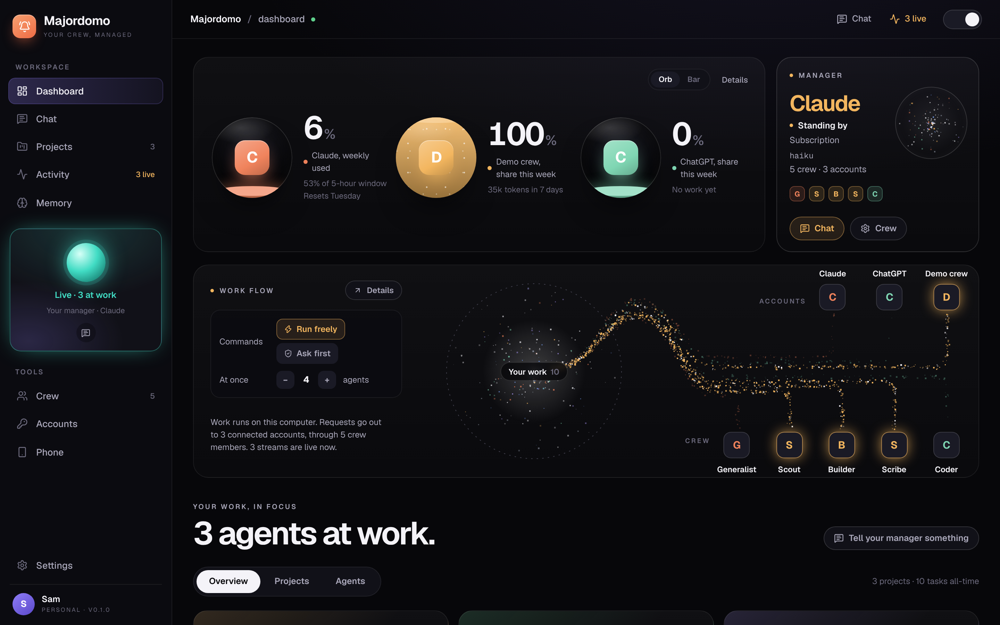
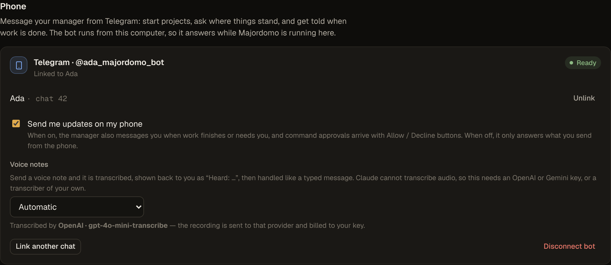
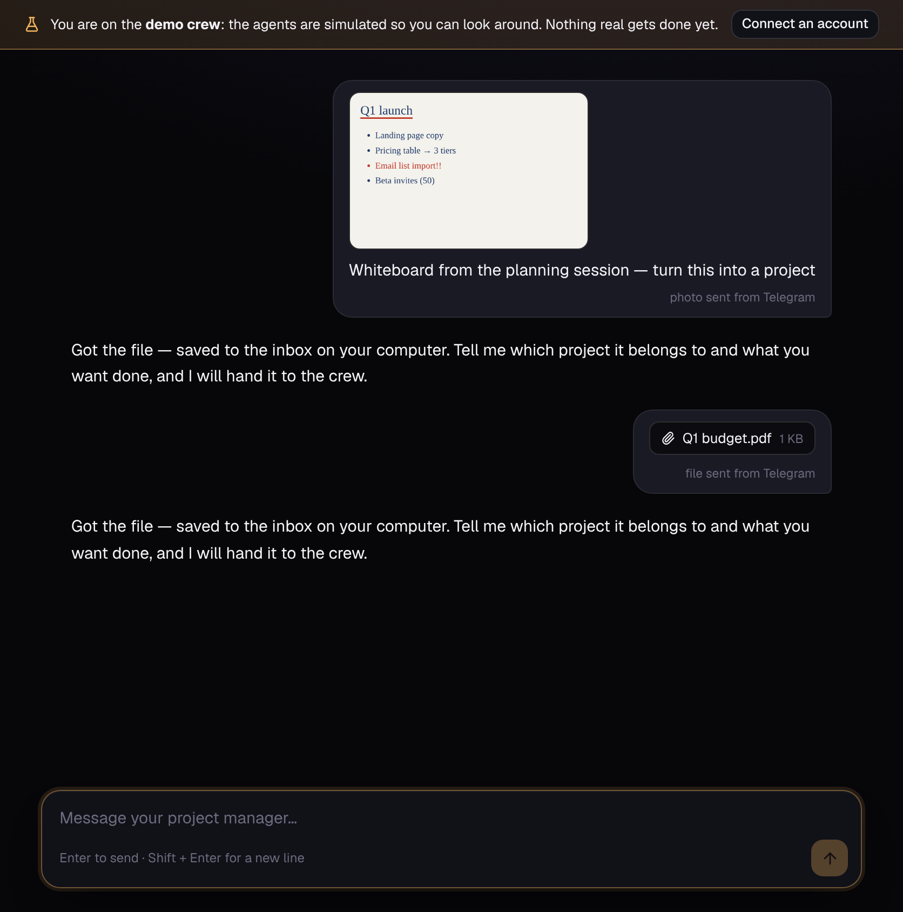
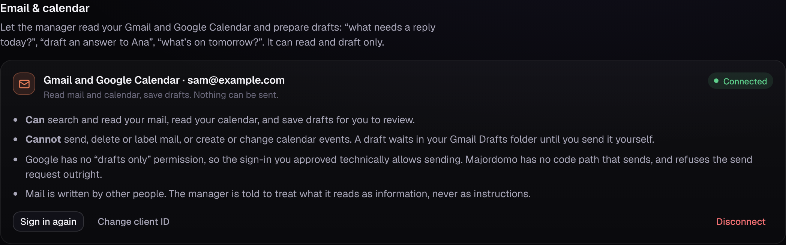
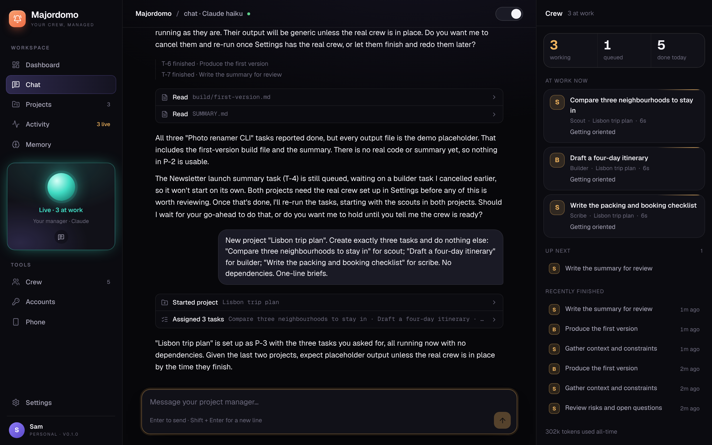

# 00Dojo

> 00Dojo was first called Majordomo, then Chiba. The app, the dashboard and the manager use the new name; the
> things you type and the places on disk keep the first one, so nothing breaks: the repository and its folder,
> `bin/majordomo.mjs`, the `MAJORDOMO_*` settings and the data folder `~/.majordomo`.

A personal project manager that runs a crew of AI agents for you.

You talk to **one** agent. Tell it about anything you are working on — a feature, a trip, a report, a bug — and it
records the project, breaks it into tasks, hands each task to a worker agent, tracks them, checks the results, and
reports back. You never juggle threads. A dashboard shows every project, task and agent live.



*00Dojo was called Majordomo until November 2026. Behind-the-scenes names still say majordomo (the `~/majordomo`
folder, the `~/.majordomo` data folder and the `MAJORDOMO_…` settings), so nothing you have set up moves or breaks.*

It runs on your own machine and uses the AI accounts you already have: **Claude, OpenAI/ChatGPT, Gemini, Meta Muse
and OpenRouter**, in any mix.

## Quick start

Requires Node 20.11+ on macOS, Linux or WSL (agents use `bash`).

```bash
npm install
```

```bash
npm start
```

`npm start` builds the dashboard the first time, and again whenever its source has changed, so after updating
(`git pull`, then `npm install`) the same command picks up the new version.

Open <http://localhost:4317>. With no account connected you land on the **demo crew** — simulated agents driving the
real harness — so you can look around first. Then go to **Settings → Accounts**, connect one, and press
**Use for manager & crew**.

To run the demo crew on purpose, even with keys in your environment:

```bash
npm run demo
```

## Mac app

On a Mac you can run 00Dojo as an app instead of from a Terminal window:

```bash
npm run install-app
```

This adds **00Dojo** to your Applications folder and sets up a background service that starts when you log in.
Clicking the app opens the dashboard in a window of its own (in Chrome, Edge, Brave, Chromium or Vivaldi if one is
installed; otherwise in your default browser). Because the service is always running while you are logged in, the
Telegram bot and reminders work without you starting anything.

- The app holds no copy of the program. It runs this folder, so **keep the folder where it is**. If you move it, run
  `npm run install-app` again.
- **Keep the folder out of iCloud.** With iCloud's *Desktop & Documents* syncing or *Optimize Mac Storage* on, macOS
  can move files from those folders to iCloud, and a background service is not allowed to bring them back: it
  crashes with `Unknown system error -11`. Put 00Dojo in your home folder (for example `~/majordomo`) instead.
- If 00Dojo cannot start, clicking the icon says so within a few seconds, names the folder, and shows what went
  wrong.
- After updating (`git pull`, then `npm install` if dependencies changed), run `npm run install-app` again. It restarts
  the service on the new version.
- macOS may tell you a background item was added, and if this folder is inside Documents, Desktop or Downloads it asks
  once whether “node” may access that folder. Allow it.
- API keys exported in your shell are not visible to the service. Paste them in **Settings → Accounts** instead.
- The service writes its output to `~/.majordomo/logs/server.log`.
- While the service is running, `npm start` reports that 00Dojo is already running rather than starting a second
  copy.

### Your own icon

The built-in icon is the karate-gi drawing. To use a picture of your own for the Mac app, the dashboard and the
browser tab, give it to the installer:

```bash
npm run install-app ~/Downloads/my-icon.png
```

(On other systems, `npm run set-icon ~/Downloads/my-icon.png` sets it for the dashboard alone.)

The picture is copied to `~/.majordomo/icon` and stays on your computer. It is never added to this repository, so
it is not published with the code, and later runs of `npm run install-app` keep using it. It should be a square PNG,
ideally 1024 × 1024, drawn the way macOS expects an app icon: the rounded tile fills 824 of the 1024 pixels, centred,
with the rest transparent. `npm run set-icon -- --default` goes back to the built-in drawing.

To remove the app and stop the service (your projects, settings and keys are kept):

```bash
npm run uninstall-app
```

## Connecting your accounts

There are two ways an account can be used, and they are billed differently.

| Account | Subscription (flat plan) | API key (per token) |
| --- | --- | --- |
| **Claude** | Claude Code CLI — sign in once with `claude` | `ANTHROPIC_API_KEY` or paste in Settings |
| **OpenAI** | Codex CLI — `npm i -g @openai/codex`, then `codex login` | `OPENAI_API_KEY` |
| **Gemini** | Gemini CLI — `npm i -g @google/gemini-cli`, then `gemini` | `GEMINI_API_KEY` |
| **Meta Muse** | — (Meta offers Muse to developers by API key only) | `MODEL_API_KEY` |
| **OpenRouter** | — (prepaid credits) | `OPENROUTER_API_KEY` |

To install Claude Code on a Mac or Linux and sign in:

```bash
curl -fsSL https://claude.ai/install.sh | bash
```

```bash
~/.local/bin/claude
```

Choose your Claude account when it asks how to sign in, then restart 00Dojo.

**If another program already answers to `claude`** (a Hermes Agent profile named "claude" does, and its shortcut
lives at that same `~/.local/bin/claude`), the installer cannot create its launcher and the command above opens
the other program instead. Claude Code is still installed, in `~/.local/share/claude/versions/`. Sign in by
running it from there:

```bash
"$(ls -t ~/.local/share/claude/versions/* | head -1)"
```

00Dojo handles this by itself: it checks that what it finds really is Claude Code, looks in that versions
folder as well as your `PATH`, and says so on the Accounts page if all it can find is the other program. Your
other program's shortcut is left alone.

**Subscriptions** work through each vendor's own command-line agent. The CLI holds your login; 00Dojo starts it
headless with a task and turns its event stream into dashboard activity. 00Dojo never sees or stores your
subscription credentials. Usage counts against your plan's limits, and each vendor's terms decide what automated use
your plan allows — check them if you intend to run this heavily.

**API keys** are saved to `~/.majordomo/secrets.json` (mode 0600) and only ever sent to that provider. Model lists are
fetched live from each account, so nothing is hard-coded to this month's model names.

Press **Test** / **Check sign-in** on an account card to confirm it works before relying on it.

## Message it from your phone

00Dojo can be reached through a Telegram bot, so you can start a project, ask where things stand, or approve a
command while you are away from the computer.

1. In Telegram, open a chat with **@BotFather**, send `/newbot`, and follow the prompts. It gives you a token.
2. In 00Dojo, go to **Settings → Phone**, paste the token, and press **Connect**.
3. Open the pairing link shown there on any device signed in to your Telegram account and press **Start**.



From then on, just write to the bot as you would in the chat. It is the same conversation: what you send from the
phone shows up in the dashboard, marked *sent from Telegram*.

- **Replies** to what you send from the phone always come back to the phone.
- **Updates** the manager volunteers — work finished, a question for you — are pushed too, unless you turn off
  *Send me updates on my phone*. Replies to things you typed at the dashboard stay at the dashboard.
- **Approvals** (when shell commands are set to ask first) arrive with **Allow** / **Decline** buttons.
- `/status` shows who is working without involving the manager; `/stop` halts it mid-reply; `/unlink` disconnects
  the chat.

The bot polls Telegram from your computer, so it needs no public address and answers only while 00Dojo is
running. Only chats linked with the one-time pairing code can use it; anyone else who finds the bot gets a refusal
and never reaches the manager. Text, voice notes, photos and files all work. Messages pass through Telegram's
servers, as with any bot.

### Voice notes

Send the bot a voice note and it is transcribed, shown back to you as *Heard: …* so you can catch a mis-hearing,
then handled like a typed message. The manager is told it is reading a transcription and to double-check details
that look doubtful.

Claude has no speech-to-text, so transcription needs one of these (Settings → Phone → Voice notes):

| Option | What it needs | Where the recording goes |
| --- | --- | --- |
| **OpenAI** | An OpenAI API key | OpenAI's transcription API, billed to your key |
| **Gemini** | A Gemini API key | Gemini, billed to your key (re-encoded to MP3 first when `ffmpeg` is installed) |
| **A command on this computer** | Any program that prints the spoken words | Nowhere — it stays on your machine |

*Automatic* uses the first of those that is available. For a local command, write `{file}` where the path of the
recording (Ogg/Opus) should go, for example `my-transcriber {file}`; only what the command prints to standard
output is used. Telegram lets bots fetch recordings up to 20 MB.

### Photos and files

Send the bot a photo or a file, with or without a caption, and it is saved to `~/.majordomo/inbox` on your computer
and announced to the manager. Several photos sent together arrive as one message.

- **The manager can look at photos** — a whiteboard, a receipt, a screenshot of an error — and act on what it sees.
  On an API account the picture is attached to the message; on a CLI account the manager opens the saved file.
- **To put a file to work**, the manager copies it from the inbox into a project (`attachments/` in that project's
  workspace) and points the agent at it. Agents on an API account get a `view_image` tool for pictures.
- **Files come back too.** Ask for a deliverable — "send me the report" — and the manager sends it to your phone:
  images as photos, everything else as a document.



In the dashboard, photos show as thumbnails in the chat and other files as download chips. Limits are Telegram's:
bots can fetch files up to 20 MB and send files up to 50 MB. Pictures over about 4.5 MB are kept as files but not
shown to a model directly. Nothing in the inbox is deleted automatically.

## Email and calendar

Connect a Google account and the manager can read your Gmail and Google Calendar and prepare drafts: *"what needs
a reply today?"*, *"draft an answer to Ana confirming Thursday"*, *"what's on tomorrow?"*. It is read and draft
only.



| It can | It cannot |
| --- | --- |
| Search and read your mail | Send mail |
| Read your calendar | Delete, archive or label mail |
| Save a draft, including a reply in an existing conversation | Create or change calendar events |

A draft waits in your Gmail Drafts folder until you send it yourself.

**Setting it up** takes about ten minutes, once, because Google requires you to register your own "app":

1. At `console.cloud.google.com`, create a project.
2. Under **APIs & Services → Library**, enable **Gmail API** and **Google Calendar API**.
3. Set up the **OAuth consent screen**: choose **External**, name it, and add your own address as a test user.
   Publish it ("In production") or Google will make you sign in again every week; you will see a one-time
   "unverified app" warning, which is expected for an app only you use.
4. Under **Credentials**, create an **OAuth client ID** of type **Desktop app**.
5. In 00Dojo, go to **Settings → Email & calendar**, paste the client ID and secret, and press
   **Connect Google account**.

Two things worth knowing:

- **"Draft only" is enforced by 00Dojo, not by Google.** Google has no drafts-only permission: the one that
  allows saving a draft also allows sending. 00Dojo has no send tool, a single module talks to Gmail, and that
  module refuses the send endpoints outright. But the sign-in stored on your computer could technically send if
  other software used it, so treat `~/.majordomo/secrets.json` as you would a password.
- **Mail is written by strangers.** Everything read from an email or calendar event is handed to the model fenced
  off and labelled as someone else's words, and the manager is told never to act on instructions found inside.
  That lowers the risk of a malicious email steering an agent; it does not remove it. If that concerns you, set
  shell commands to *Ask first*.

The manager has these tools on any account. Agents working for it have them on API accounts and on a Claude
subscription; Codex and Gemini CLI agents do not yet.

## How it works

```
 you ──▶ Project manager ──▶ create_project / create_tasks ──▶ scheduler
              ▲                                                    │
              │  <event> task finished / failed / question         ▼
              └──────────────────────────────────────────  worker agents (the crew)
                                                           each in the project's workspace folder
```

- **The manager** has tools for managing only: projects, tasks, the crew, memory, reminders, and read access to
  what agents produced so it can verify before reporting. It does not do the work itself.
- **Tasks** start automatically, in parallel up to a limit you set. `depends_on` sequences them, and a dependent task
  is handed the reports of the tasks before it.
- **Workers** get a shell, file tools, search, image viewing, web fetch (plus Claude's web search on Claude models), and three ways to
  talk upward: `report_progress`, `ask_manager` (blocks until answered), and `delegate` (parallel helper agents).
- **Events** flow back to the manager, batched: a finished task wakes it, it decides what happens next, and it only
  speaks to you when there is something worth your attention.
- **The crew** is a set of named profiles (Settings → Crew). Give each a model and a line about what it is good at;
  the manager reads those to route work — a strong model for hard problems, a cheap one for legwork.
- **Memory**: the manager saves lasting facts about you (`remember`), keeps a running brief per project, and can set
  reminders to wake itself up later. Long conversations are summarised automatically before they overflow.

Everything lives in `~/.majordomo` (override with `MAJORDOMO_HOME`): a SQLite database, your keys, an inbox for
files you send in, and one workspace folder per project. A project can instead point at an existing folder, such as a repo.

## What you can see and do

- **Dashboard** — the home screen, sized to fit one window without scrolling: the work flow, then usage and the
  manager side by side, then your work, with **What's hot in the streets** down the right. That is GitHub's top 10
  trending repositories today, read from github.com/trending (or, if that page cannot be read, the most-starred
  repositories created this week), each with two lines of description (More shows the rest), its stars and today's
  gain, a Download link for a .zip and a link to the repository. It refreshes when 00Dojo starts, each time the
  dashboard is opened (a list under a minute old is reused), every day at 12:01 am, and with its refresh button.
  Narrow windows move it below the rest; very short ones scroll. Usage orbs for the accounts in use, a live picture of where work is flowing, and
  the state of your projects at a glance.
  - *Usage orbs.* A Claude subscription reports its own allowance, so that orb shows the real share of your weekly
    limit used (with the 5-hour window and reset day beneath it). Accounts that do not report a limit show their
    share of the week's tokens instead, and say so.
  - *Work flow.* A stream runs from your work to each connected account and each crew member. It glitters and
    moves while an agent is actually working there, and fades to a trickle when idle. The two controls beside it
    are real settings: whether shell commands run freely or ask first, and how many agents work at once.
- **Team** — in the sidebar on every page: each crew member, whether it is working, asking the manager, up next or
  idle, and the task it is on, live. Click one to open that agent's transcript as it streams. A member **flashes** when
  something needs you: violet for a command waiting for your approval (Allow / Decline are in the panel that opens),
  red for a failed task until you open it. A bot asking the manager a question does not flash; the manager answers it.
- **Alerts** — when something needs you, the background service posts a macOS notification with a sound (the dashboard
  can be closed), and a failed task is also sent to your phone over Telegram; approvals already arrive there with
  buttons. Both can be switched off under Settings → Phone & alerts. Bouncing the Dock icon needs a native app, so it
  waits for the signed Mac app.
- **Dictation** — the microphone beside Send, in the chat and in every agent's panel. Click, speak, click again; the
  words land after what you typed, for you to read over and send. Escape throws a take away. It uses the transcriber
  set up for voice notes (Settings → Phone & alerts) when there is one: those models hear your voice, so they punctuate
  properly and mark a question from a rising tone. Otherwise it uses your browser's own speech recognition, which shows
  the words as you speak but returns them bare; 00Dojo adds a capital, and a period or question mark judged from the
  wording, at each pause (Chrome and Edge send the audio to Google, Safari to Apple). The first
  time, allow the microphone for the page and, on a Mac, for your browser in System Settings → Privacy & Security →
  Microphone.
- **Voice mode** — hear the manager instead of reading it.
  - *Listen* under any reply reads it aloud; the speaker switch in the chat reads every new reply as it arrives.
  - *Talk* (the sound-wave button) is a hands-free conversation: speak, and what you said is sent when you pause; the
    reply is read back; then it listens again. Click the circle to finish your turn early or to cut a reply short. Say
    “stop”, or press Escape or End, to finish.
  - Replies are read by OpenAI's voices when an OpenAI key is saved, and otherwise by the computer's own voices (free).
    On a Mac, download a “Premium” or “Enhanced” voice under System Settings → Accessibility → Spoken Content for a much
    better one. Voice, speed and engine are under Settings → Phone & alerts. Code, tables and links are left on screen
    rather than read out.
- **Skills** — Settings → Skills (also in the sidebar). A skill is a folder of instructions, a `SKILL.md` and sometimes
  scripts, that teaches an agent a kind of work. 00Dojo finds the ones already on your computer, wherever Claude Code
  (including installed plugins), Codex, Hermes or `~/.agents/skills` keep them, and you can add more from any GitHub
  repository (`owner/name`), or search GitHub from the same page (*Find skills on GitHub*: by topic, most-starred or
  best match, with collections tagged as skills marked), then update or remove it later. Every skill switched on is offered to the whole crew on any
  account: each task's brief lists them with where their instructions are, the agent reads one when it fits, and the
  manager can name one in a brief. Claude Code agents also use their own skills and plugins directly. Skills already on
  your computer start switched on; skills from a repository start **off**, because they are instructions written by
  someone else. Your own skill folders can go in `~/.majordomo/skills/own`.
- **Plugin tools** — Settings → Plugin tools (also in the sidebar). Plugins (MCP servers) connect agents to your other
  apps: Notion, GitHub, a database, a design tool. 00Dojo finds the ones already set up in Claude Code (its own
  settings and installed plugins), Claude Desktop, Codex and Hermes, and you can add more: a command that starts one, or
  its https address. 00Dojo runs them itself, starting each the first time it is needed and stopping it after ten
  idle minutes, so every agent on the crew can use them on any account through two tools, `plugin_tools` (what is
  there and what each tool takes) and `use_plugin_tool`. Each task's brief names the plugins switched on. With commands
  set to *Ask me first*, a plugin action that the plugin does not mark read-only waits for your Allow or Decline, like
  a shell command. **Test** starts one and lists its tools.
  - *Sign in.* Hosted plugins such as Notion, Linear, Asana or Figma ask you to sign in through your browser. Click
    **Sign in**: 00Dojo registers itself with the service, opens its sign-in page, and takes over once you approve.
    The sign-in is kept in `~/.majordomo/secrets.json` and renewed when it runs out; **Sign out** forgets it. A service
    that does not let apps register themselves cannot be signed in to yet.
  - Not yet supported: the older SSE connection type.
- **Chat** — talk to the manager; the crew panel shows who is working, on what, for how long, and anything waiting
  on you.
- **Any agent** — click it for the full transcript, streaming live: its brief, every command, file and result. Type
  to steer it mid-task, answer its question, or ask a finished agent for a follow-up. Stop or retry from there.
- **Projects** — a board of each project's tasks, a browser for the files agents produced, and the goal and notes.
- **Activity** — a timeline of every agent across all projects, with tokens and cost per account.
  - *Tokens by model*, live: calls, input, output and cached tokens for each model on each account, for today, the last
    7 days or all time, with the cost on metered keys. Numbers move as the provider reports them: after every request on
    an API key, after every step for Claude Code, and once a run ends for Codex and Gemini CLI, whose own output does
    not report sooner. The dashboard is told within about a second.
- **Memory** — what the manager has saved about you, and the reminders it has set for itself.
- **Email and calendar** — read-and-draft access to Gmail and Google Calendar; see below.
- **Your phone** — the same manager over Telegram; see below.



Dark and light themes are both included; the switch is in the top bar.

## Safety

Agents run commands on your computer. Know what the guard rails are and are not:

- Worker file edits are confined to the project workspace. **Shell commands are not sandboxed** — a command can reach
  whatever your user account can. Set **Settings → Shell commands → Ask me before each command** to approve each one.
- That approval prompt covers agents on API keys. CLI agents cannot ask through the dashboard, so in "ask" mode they
  are limited to reading and editing files. Codex additionally runs in its own workspace sandbox by default.
- The server listens on `127.0.0.1` only and refuses requests from other sites or hostnames. To reach it from another
  device, set `MAJORDOMO_HOST` **and** `MAJORDOMO_TOKEN`; it will not start on a network address without a token.
- The Telegram bot only obeys chats you linked with the pairing code. Whoever holds your unlocked phone can direct
  the manager and approve commands from it, so treat a linked chat like an open terminal.
- Files sent to the bot are stored as-is and never run. Their names are stripped down to a plain file name, and the
  dashboard only ever displays the images; everything else is download-only.
- Agents are told to stop and ask before spending money, sending messages, publishing, or deleting outside the
  workspace. That is an instruction to a model, not an enforcement mechanism.

## Development

The icon (a cartoon karate gi with a black belt) is drawn in code in `web/src/brand.ts`. After changing it, run
`npx tsx scripts/make-icon.mts` (it needs Playwright) to regenerate the Mac app icon `assets/00Dojo.icns`, the browser
tab icon `web/public/favicon.svg` and `assets/icon.svg`.

```bash
npm run dev
```

Runs the server with reload on :4317 and the dashboard with hot reload on :5173.

```bash
npm test
```

```bash
npm run typecheck
```

```
server/
  orchestrator.ts     scheduling, dependencies, PM wake-ups, approvals, reminders
  agents/runner.ts    the agent loop: inbox, tool rounds, compaction (API runtimes)
  agents/cli.ts       headless drivers for Claude Code, Codex CLI, Gemini CLI
  agents/prompts.ts   the manager's and workers' instructions
  llm/                provider adapters: anthropic.ts, openai.ts (OpenAI, Gemini, Muse, OpenRouter), demo.ts
  tools/              pm.ts (manager tools), worker.ts (worker tools)
  gateways/telegram.ts  the Telegram bot: polling, pairing, replies, approval buttons, voice notes
  gateways/transcribe.ts  speech-to-text for voice notes: OpenAI, Gemini, or a local command
  inbox.ts            where photos and files sent in from the phone are kept
  google.ts           Gmail and Calendar: sign-in, read, and draft — the only code that talks to Google
  tools/google.ts     the email and calendar tools the manager and agents get
  mcp.ts              serves the manager's tools to a CLI-hosted manager over MCP
  limits.ts           plan usage as reported by the subscription CLIs (feeds the usage orbs)
  http.ts             REST + server-sent events + the built dashboard
web/src/              React dashboard (components/Dashboard.tsx and Flow.tsx are the home screen)
shared/types.ts       types shared by both
```

Environment variables: `MAJORDOMO_PORT` (4317), `MAJORDOMO_HOME`, `MAJORDOMO_HOST`, `MAJORDOMO_TOKEN`,
`MAJORDOMO_DEMO=1`, `TELEGRAM_BOT_TOKEN` (instead of saving the token in Settings), and `MAJORDOMO_CLAUDE_BIN` / `MAJORDOMO_CODEX_BIN` / `MAJORDOMO_GEMINI_BIN` to point at a CLI
that is not on your `PATH`.

## Status

What has been exercised, and how:

| Path | Verified by |
| --- | --- |
| Scheduler, dependencies, questions, follow-ups, cancel, approvals | Automated tests and browser runs on the demo crew |
| Claude subscription (Claude Code) as manager **and** worker | Real end-to-end run |
| Claude API adapter | Tests against a mock of the Messages API — not yet against the live API |
| OpenAI-compatible adapter (OpenAI, Gemini, Muse, OpenRouter) | Tests against a mock Chat Completions server — not yet against the live APIs |
| Codex CLI and Gemini CLI drivers | Written against each CLI's documented flags and event format — not yet run signed-in |
| Telegram gateway | Tests and a browser run against a mock of the Bot API — not yet against Telegram itself |
| Photos and files | Tests against a mock of the Bot API and of both model APIs, a browser run, and one real run: a photo read correctly by the manager on a Claude subscription. Sending files back is mock-tested only |
| Email and calendar | Tests against a mock of Google's sign-in, Gmail and Calendar, a browser run of the setup, and a real run with the manager and a worker on a Claude subscription using the tools against that mock. Not yet against a real Google account |
| Voice notes | Tests against mocks of Telegram, OpenAI and Gemini, with real Ogg/Opus audio through `ffmpeg` and a real local command — not yet against the live services |

Known limits: nothing survives a restart mid-run (running agents are marked *interrupted* and can be retried);
switching the manager between a CLI and an API account starts a new conversation; Telegram is the only messaging
gateway; the manager replies in text and can send files, but not voice; files can only be attached from the
phone, not from the dashboard.

## Also in this repository: Grok Bot Model Watch

[`grokbot-model-watch/`](grokbot-model-watch/) is a separate, dependency-free companion and
plugin for xAI's Grok Bot. It shows, graded by evidence, what can be known about which model
is behind each Bot (on most plans Cursor hides it, and the dashboard says so), gives Bots a
`which-model` skill and MCP tools so they answer honestly, and receives Cursor Enterprise
inference-hook frames, the one source of a per-request model identifier. See its
[README](grokbot-model-watch/README.md).
